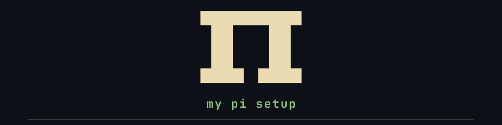

This is my current [pi](https://github.com/earendil-works/pi) setup.

It's got extensions, skills, and associated tools that I integrate with my main workflow.

## How to use this repo

Do not clone or try to install anything from here.
Instead: point your agent at this repo, or at one part of it, and ask it to build that piece in your own setup.
It's a showroom, not an installer.

## Core setup

- **[pi](https://github.com/earendil-works/pi)** — the agent harness
- **[herdr](https://github.com/herdrdev/herdr-app)** — the agentic terminal app I am currently using. It's divided into two parts: the frontend app (herdr) and the 'core' (hc).
- **[tandem](https://github.com/Algorant/tandem)** — my agent task management system, written in rust.
- **[herdra](https://github.com/Algorant/herdra)** — my orchestration protocol which is integrated directly with pi/herdr/tandem. I talk to one agent, and it delegates to the fleet.

## Extensions

- **[pi-agency](extensions/pi-agency/README.md)** — all things related to agents, subagents, etc
- **[pi-herdr](extensions/pi-herdr/README.md)** — custom extension for herdr and herdr-core (hc)
- **[pi-fff](extensions/pi-fff/README.md)** — custom extension for [fff](https://github.com/dmtrKovalenko/fff)
- **[pi-memory](extensions/pi-memory/README.md)** — my simple memory system, which goes to my obsidian vault
- **[pi-providers](extensions/pi-providers/README.md)** — all things related to various providers and my settings for them
- **[pi-sideshow](extensions/pi-sideshow/README.md)** — dedicated extension for [sideshow](https://github.com/modem-dev/sideshow)
- **[pi-tandem](extensions/pi-tandem/README.md)** — dedicated extension for [tandem](https://github.com/Algorant/tandem)
- **[pi-todos](extensions/pi-todos/README.md)** — a small todo list for the current session
- **[pi-ask-me](extensions/pi-ask-me/README.md)** — my custom 'decisions' style dialog pop-up for pi
- **[pi-ui](extensions/pi-ui/README.md)** — my various custom ui tweaks. custom header, footer, toolcall renders, etc
- **[pi-web-tools](extensions/pi-web-tools/README.md)** — web search, browser use, and other web based tools extension. powered by things like [ketch](https://github.com/Algorant/ketch), [obscura](https://github.com/h4ckf0r0day/obscura), and [xurl](https://github.com/xdevplatform/xurl)

## Skills

- **[agency](skills/agency/SKILL.md)** — companion skill to pi-agency
- **[ask-me](skills/ask-me/SKILL.md)** — companion skill to pi-ask-me
- **[audit](skills/audit/SKILL.md)** — WIP, what I reference when I want to review something or give it another pass
- **[browsing](skills/browsing/SKILL.md)** — the browser an agent uses, obscura by default, browse on request
- **[herdr](skills/herdr/SKILL.md)** — companion skill to pi-herdr
- **[memory](skills/memory/SKILL.md)** — companion skill to pi-memory
- **[projectify](skills/projectify/SKILL.md)** — skill to bootstrap a new project
- **[scriptify](skills/scriptify/SKILL.md)** — skill that turns requests into custom bespoke scripts, good for elevated permissions/sudo requests etc
- **[sideshow](skills/sideshow/SKILL.md)** — companion skill to pi-sideshow
- **[studio](skills/studio/SKILL.md)** — house style for diagrams, drawings, video, and other artifacts. dedicated areas for things like excalidraw, fframes, pele, etc
- **[tandem](skills/tandem/SKILL.md)** — companion skill to tandem
- **[utils](skills/utils/SKILL.md)** — catch-all skill for common agentic utilities: secrets, databases, file transfers, and how I prefer to have them done/set up
- **[worktrunk](skills/worktrunk/SKILL.md)** — skill for using worktrunk/managing worktrees for projects
- **[xurl](skills/xurl/SKILL.md)** — skill to use xurl, a CLI for x/twitter

## Dependencies

[pi](https://github.com/earendil-works/pi) · [herdr](https://github.com/herdrdev/herdr-app) · [obscura](https://github.com/h4ckf0r0day/obscura) · [fff](https://github.com/dmtrKovalenko/fff) · [fnox](https://github.com/jdx/fnox) · [ketch](https://github.com/Algorant/ketch) · [obsidian](https://obsidian.md/) · [sideshow](https://github.com/modem-dev/sideshow) · [tandem](https://github.com/Algorant/tandem) · [worktrunk](https://github.com/max-sixty/worktrunk) · [xurl](https://github.com/xdevplatform/xurl)

## Theme

[verdigris](https://github.com/Algorant/omarchy-verdigris-theme)

## License

[MIT](LICENSE)
