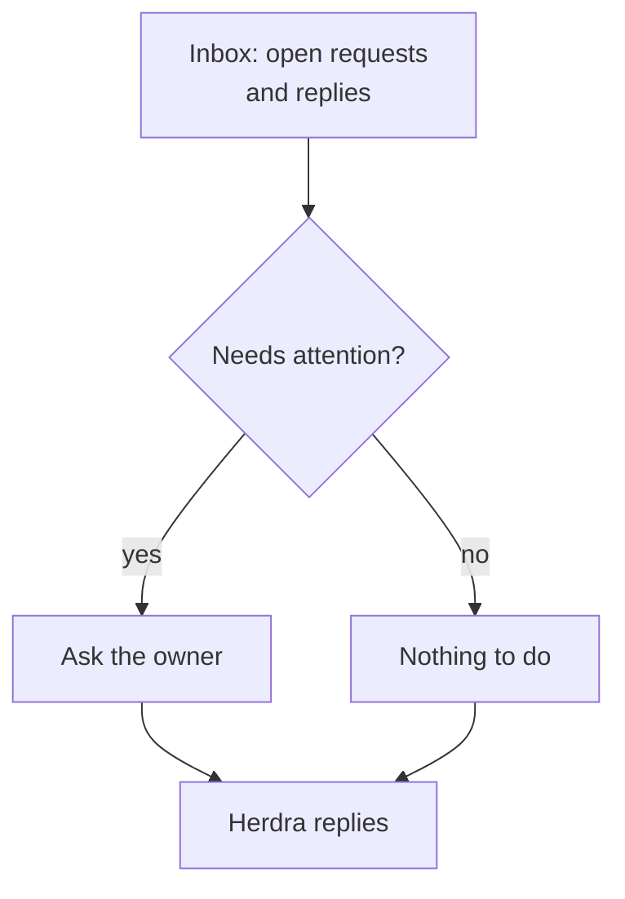

# Studio

House style for things made for a person to see. Pick the tool by the job
(table below), apply the shared style, then follow that tool's section. Each
kind of creation has its own section in the same shape (when to use, how, the
rules that matter); a new kind gets a new section and a row in the table.

Requirements: Bun, the local studio install at `~/.local/share/pi-studio`
(`pele`, `@resvg/resvg-js` and `@pierre/words`, all `latest`), and Liberation
Sans/Mono for PNG output. One-time setup, and the command both renderers print
when the install is missing:

    mkdir -p ~/.local/share/pi-studio
    cp ~/.pi/agent/skills/studio/package.json ~/.local/share/pi-studio/
    cd ~/.local/share/pi-studio && bun install

Refresh that install with `bun update` in the same directory.

## Which tool for which job

| Job | Tool | Result |
| --- | --- | --- |
| A diagram or chart from text (flow, sequence, state, architecture, timeline, xychart, …) for notes, READMEs, plans, research artifacts, image views or presentations | [Pele](#pele) | Verdigris SVG and PNG files |
| A diagram in Pi chat | Pi's built-in Mermaid renderer ([Mermaid in Pi chat](#mermaid-in-pi-chat)) | Unicode diagram in the transcript when supported and narrow enough; otherwise source |
| A diagram in a Sideshow post | Sideshow `kind:"mermaid"` (the `sideshow` skill) | Sideshow renders it with Pele itself; do not render or upload Pele files there |
| A document someone reads end to end: a report, spec, research write-up or handout, especially one with math, tables or diagrams | [Words](#words) | a self-contained Verdigris HTML page, or a terminal view |
| A drawing Algorant opens and edits by hand: a sketch, a whiteboard, a layout he will move around | [Excalidraw](#excalidraw) | an `.excalidraw.md` drawing in his vault |
| A video, animation, motion graphic, teaser, title card or poster | [fframes](#fframes) | a rendered video (draft first) |

Reach for Pele first for a diagram or chart deliverable; use a fenced Mermaid
block for a compact diagram being discussed in Pi chat, and Sideshow's Mermaid
surface for a diagram in a Sideshow post. Choose Words for a whole document,
Excalidraw only when Algorant will work on the drawing himself, and fframes
only for motion or a rendered video.

## Shared style

### Verdigris palette

Everything uses Algorant's Verdigris palette (`~/Projects/verdigris`;
canonical data in `palette/verdigris.json`). Verdigris is a dark theme:
design dark first, and offer light only as an optional convenience (for
example `prefers-color-scheme`), never as a default, a first option or a
recommended pick.

| Core | Hex | Role |
| --- | --- | --- |
| ashbronze | `#665c54` | background / weathered metal |
| vellum | `#ebdbb2` | foreground / warm text |
| fern | `#8ec07c` | bright green accent |
| patina | `#689d6a` | primary green |
| aqua | `#83a598` | cool aqua accent |
| ochre | `#e6bf86` | warm brass accent |

Additional colours for roles outside the core: moss `#70764a`
(additions/success), teal `#458588` (secondary blue-teal), oxblood `#74363d`
(removals/errors; a fill, too dark for text: red text uses `#c66f70`),
goldenrod `#b8863b` (warnings/search), deep copper `#b9805f`
(changes/caution), ink-violet `#8989b0` (rare accent).

Each tool carries its own tuned Verdigris: Pele's
[`pele/verdigris.json`](pele/verdigris.json), the Excalidraw skill's `V`
table of stored colours, and fframes' `verdigris-dark` preset plus its
`verdigris-paper` light convenience (never the default). Use those rather
than pasting raw hex.

### Taste rules

- **Smallest thing that works.** Use the smallest suitable diagram; about 12
  nodes at most, otherwise split it. In video, several short scenes beat one
  long one.
- **Short labels.** One idea per node in a few words; detail goes in the
  reply or the text around it, not the picture.
- **Colour shows role.** Give the same kind of thing the same colour, and use
  only a few roles per piece.
- **Real content.** Label illustrative data as illustrative; never invent
  values shown as real. Copy and calls to action that are not in the source
  are Algorant's to give.
- **Look before showing.** View the rendered PNG or an extracted frame yourself with the `read` tool before reporting it, and fix crowding, overlaps, crossed arrows and low contrast (small muted text on dark is the least readable) before Algorant sees it.
- Taste, brand and visible results are Algorant's call (global AGENTS.md,
  *Only Algorant decides*): deliver visible work for his look.

### Media fidelity

Highest quality wins (Algorant: "highest quality wins always unless some other important mitigating factor involved").

- **Stills** (screenshots, README, site and gallery images): ship the original lossless file, byte for byte. Set the display size in markup (`width="…"`); never make derived thumbnails or re-encode to JPEG or lossy WebP.
- **Video and animation:** keep source resolution and frame rate and encode for quality, not to a size (H.264 CRF 18 or lower, as in Verdigris's showcase-clips recipe). Where only an image format plays inline (a looping README demo), use lossless animated WebP at native size.
- **Caps come last.** Check a host or tool cap (GitHub 10 MB per video attachment, Sideshow 5 MiB per asset) only after the best version exists. If a cap forces a smaller copy, keep the master, label the copy a preview wherever it appears, and never ship the preview as the deliverable.
- **Mitigating factors are concrete:** a hard host cap, a source that is itself lossy, privacy redaction, or Algorant's explicit choice. A smaller repo or page weight is not one.
- **Say what was lost.** A delivery names every lossy, downscaled or sped-up step and its reason. A number Algorant gave ("about 10 seconds", "q90") is quoted as his words, never turned into a cap or target.
- **Context views are not output.** The 1024 px image limit in global AGENTS.md governs what you load into context; judge detail on crops of the original, never on a downscaled copy.

### Mockups and proof

A mockup of something Algorant will see in Obsidian, a Pi pane or the Herdr app is made by the real generator or renderer, in that real target, at 1:1, with representative real data. An HTML or hand-painted sketch is allowed only labelled 'direction, not for approval'. As-built proof is a capture from the same target, shown beside the approved image at 1:1 (crop, never shrink). Re-painting with the mockup's own painter proves nothing.

## Mermaid in Pi chat

Use a top-level fenced `mermaid` block for a small diagram you want to read in
Pi's transcript. Pi renders supported diagrams as Unicode in the TUI; rendering
can fall back to the original source when syntax is unsupported or the drawing
is wider than the available message width. That width depends on the terminal
and message layout, so a wide diagram is better as a Pele image or a Sideshow
Mermaid surface.

In Pi 1.6.0 this compact flowchart renders inline and demonstrates decisions,
labeled edges, ` ` label breaks and multi-node edges:

If a diagram falls back to source, shorten labels or split it rather than
relying on a fixed column cutoff. Keep inline Mermaid for a compact diagram in
the ongoing conversation. Use a Sideshow Mermaid surface when it belongs in a
Sideshow post, or Pele when you need SVG/PNG files for a README, note, plan or
presentation. Those image-based outputs are more suitable when a diagram is
wide or needs a shareable visual.

## Pele

### When to use
Reach for Pele first when creating a diagram or chart, then use its image files in any destination. Use the smallest suitable diagram; keep labels readable and label illustrative data.

### Render
Resolve the bundled script relative to this skill directory. From the input's working directory:

    bun ~/.pi/agent/skills/studio/pele/render.ts diagram.mmd out/

This writes `out/diagram.verdigris.svg` (literal colours) and `out/diagram.verdigris.png` (2x), and prints their paths, dimensions and timings. Use `-` instead of the input file for stdin. Verdigris is the default; the optional last argument `pele-default` uses Pele's own colours.

### Colours
Edit this skill's `pele/verdigris.json`: direct `--pele-*` keys and hex values, initially copied from the accepted showcase palette. The next render reads it. This does not change Herdr's theme.

### Examples
See `../../../plan/pele-showcase/src/`: `01-flowchart.mmd` for agent roles, `04-state.mmd` for Tandem, and `12-xychart.mmd` for an illustrative Usage chart. The showcase README lists all supported families and their syntax.

### Use the files
Use SVG or PNG in a README, plan/research artifact or image view. Render outside the vault and deliver the file; do not write it into vault notes.

### Limits
Pele outputs SVG; the script inlines CSS functions before PNG rasterisation. Widths are Arial-table estimates, so dense diagrams and non-Latin labels can still crowd. Inspect the result; shorten or split it when needed. External Mermaid plugins are unsupported. No browser or widget change is required.

## Words

### When to use
A document someone reads end to end: a report, spec, research write-up or
handout, especially one with math, tables or diagrams. Also a quick, readable
look at a `.md` file in a terminal. For a diagram alone use Pele; for something
to review with Algorant, with versions and comments, use Sideshow.

### Render
Resolve the bundled script relative to this skill directory. From the input's
working directory:

    bun ~/.pi/agent/skills/studio/words/render.ts doc.md out/

This writes `out/doc.html` (named for the input's stem), one self-contained page
with Words' own styles, the Verdigris layer, TeX math as SVG, `mermaid` fences
as Pele SVG, GFM tables and task lists. It prints one JSON line with the path,
bytes, rendered diagram count and timing. Raw HTML is removed; pass `--trusted`
for input you wrote or otherwise trust.

For a terminal view:

    bun ~/.pi/agent/skills/studio/words/render.ts doc.md --terminal 80

This prints Words' ANSI at that width (default 80) with its 256-colour accents
remapped to Verdigris truecolour. A terminal cannot draw images, so math stays
TeX and diagrams stay Mermaid source.

### Colours
`words/verdigris.css` is the document layer over Words' installed `styles.css` at `~/.local/share/pi-studio/node_modules/@pierre/words/dist/styles.css`, and it
reads the same `pele/verdigris.json` tokens the diagrams use, so a document and
the diagrams inside it match. Edit the palette there for both.

### Use the files
Open the HTML in a browser or deliver it as a file: it needs no network and
refers to no external file. Diagrams for anywhere else come from Pele. Do not
write into the vault.

### Limits
Words' math SVGs name STIX Two Math, Cambria Math and Latin Modern Math, so a
machine with none of them falls back through its generic math and serif fonts.
A renderer that rasterises SVG text without font fallback (Obscura) shows those
glyphs as boxes, so check math in a browser or a resvg raster instead. Code
fences keep their own line length: a long line wraps in the terminal and scrolls
inside its block in the page. Look at the result before sending it.

## Excalidraw

### When to use
A drawing Algorant will open and edit himself in Obsidian, or a request to
draw, sketch or diagram something in Excalidraw, or to check what changed in
a drawing.

### How
The Excalidraw project (`~/Projects/excalidraw`) owns the working skill:
`~/Projects/excalidraw/.pi/skills/excalidraw/SKILL.md`.
Pi sessions in that repository load it; from anywhere else, read that file in
full before drawing. It holds the drawing template, the stored-colour `V`
table and the read-back and look scripts.

### Rules that matter
- Drawings go only in `Agentic/excalidraw/` in the `MasterVault` vault,
  through the Obsidian CLI and the plugin's ExcalidrawAutomate API; never
  hand-write `.excalidraw.md` files or touch Algorant's own drawings or the
  plugin's settings.
- Dark mode transforms stored colours: use the skill's `V` table (or its
  `shownAs` helper), never a Verdigris hex directly.
- The PNG view is for the agent to check its own work; Algorant opens
  drawings in Obsidian.

## Demo clips from screen recordings

### When to use
Use this workflow for short demo clips cut from a screen recording. Judge the cut by whether a first-time viewer can follow it, not by file size, format or duration: a 2–3 MB animated WebP and a clip under 10 seconds were both rejected.

### How
Start with a clean, full-resolution recording made for the demo. Edit at 1× speed and trim waits rather than speeding up the footage. Give each function its own short section: show the starting window, trigger the shortcut, show the visible result, then hold on where it lands. Each section runs until its result is visible and has landed, however long that takes; there is no per-function or total length target. Do not turn the demo into a montage. Draw real keycaps on a solid panel, readable at 800 px README width, and add one line saying what to watch. If two functions look alike, separate them with a full-width title. Deliver per *Media fidelity*: H.264 MP4 at source resolution and frame rate, host cap last (GitHub Free: 10 MB per video attachment).

### Rules that matter
**Section ledger before any handoff.** Write a "what this teaches" table, one row per labelled section (each caption, keycap or title): *claim* (the label text); *ground truth* (the feature's own config, docs or source, or Algorant's words; never your own description); *span* (source timestamps); *frames show* (what frames from that span visibly show, written from the frames before reading the label); *match* (yes/no); *ends when* (the visible event the section holds until). A row without ground truth, or with match "no", is a draft: fix the cut or the label, or ask; a draft label never reaches Algorant. The reviewer checks every row against frames extracted from that section and notes the result in the row. The ledger travels with the handoff (Task note, or a Sideshow surface below the clip). If a ledger-checked clip is still caught mislabelled, the next review adds a blind describer: a read-only helper given each section's frames with no labels or brief.

Before handoff, inspect frames scaled to README width and watch the full cut. For a repository-hosted preview, reference it with a path relative to the README (for example, `./assets/demo.mp4`) and verify that path resolves on the branch; this is not a GitHub attachment-player embed. For a GitHub video attachment, put the bare uploaded URL on its own line or in a table cell so GitHub renders the player. Do not hand-write a video tag: it can leave only a redirect link. Preview the README on a branch before merge and confirm the GitHub attachment player's source is `private-user-images`. An HTTP 200 response or an encode-spec check is not visual review.

Use Verdigris's [showcase-clips recipe](https://github.com/Algorant/verdigris/blob/main/docs/showcase-clips.md) for the exact commands; do not copy them here.

## fframes

### When to use
A video, animation, motion graphic, teaser, changelog clip, title card or
poster rendered in code.

### How
Work in the fframes project (`~/Projects/fframes`), which owns the setup and
guidance; read its `AGENTS.md` first.

- Craft: the upstream `fframes-video` skill, vendored unmodified at
  `.agents/skills/fframes-video/SKILL.md` with `references/api.md`,
  `design.md` and `audio.md`. Pi loads it in that repository; do not install
  it globally.
- House style for video: `style/README.md` (fonts, the Verdigris dark
  preset, the paper light convenience, components).
- **Work to tap into:** the project's `project-video` skill
  (`.agents/skills/project-video/SKILL.md`) holds the workflow for videos
  about a software project (resolving scope, scaffolding, presets, music
  beds, checks, delivery, gotchas), and `videos/LOG.md` records what each
  video covered. (That skill calls its repository "the studio"; it means the
  fframes repo, not this skill.)

### Rules that matter
- No tests of any kind for videos; the checks are the fframes CLI outputs
  (`timeline`, `inspect`, `strip`, `frame`, `audio analyze`). Look at the
  PNGs before calling anything good.
- Render the full video only when asked; for review offer `preview <time>`
  or a draft.
- Never put renders, drafts or scratch files in `/tmp` (a RAM-backed tmpfs);
  use `~/.cache/fframes/scratch/<video>/` and render through mise.
